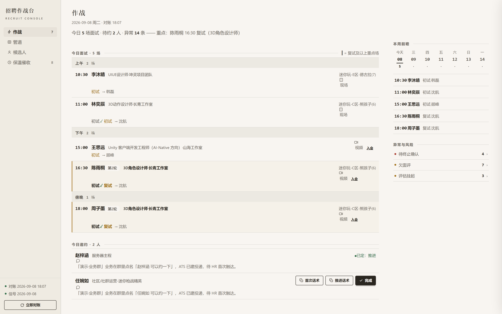
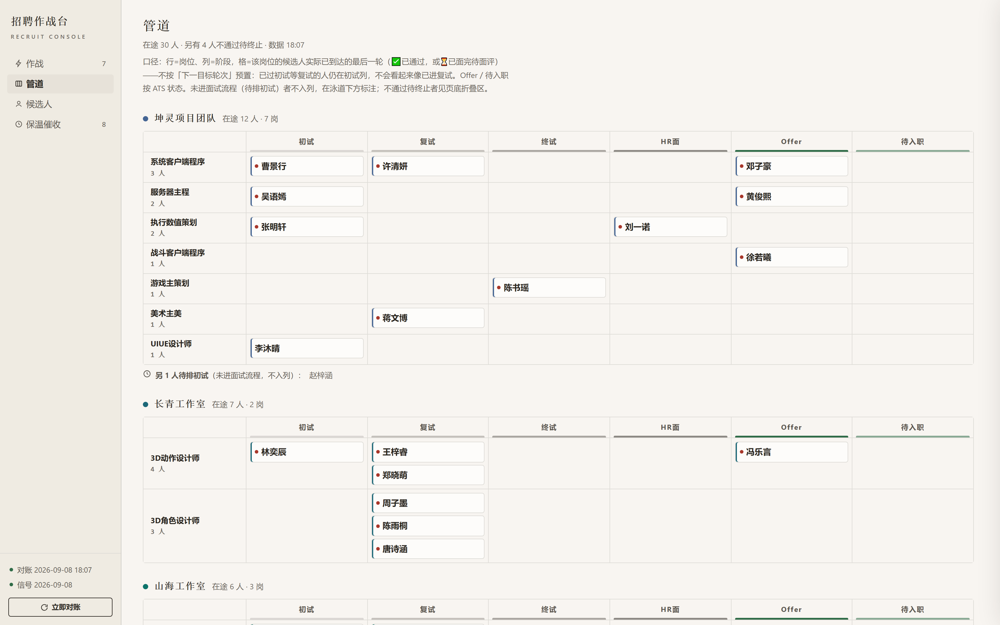
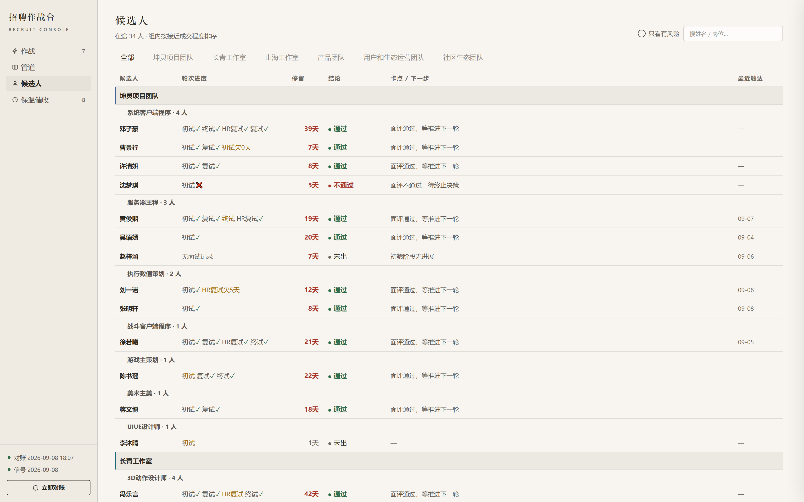
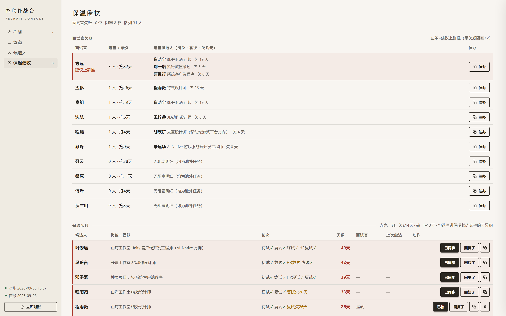

# 招聘作战台 v4

每天早晨的招聘指挥台：**作战 / 管道 / 候选人 / 保温催收** 四个页面，读当天对账数据渲染，
勾选动作直接落盘回写——不只是看板，是能"看 → 决定 → 记录"的闭环工具。

> **接手开发（含 AI 协作）先读 [AGENTS.md](AGENTS.md)**——技术栈、硬性约定、验收脚本、当前状态都在那里；本文只讲使用。

## 界面速览

> 以下截图由**匿名演示数据**生成（虚构人名/ID，结构与真实对账数据一致），截图出自 `_shots.mjs` 验收脚本。

**#/battle 作战** —— 今日面试按时段分栏（上午/下午/傍晚），复试及以上整行强化；今日邀约带话术与「完成」写回；右栏本周前瞻 + 异常与风险：

**#/pipeline 管道** —— 工作室泳道 × 岗位×阶段矩阵，行=岗位、列=六阶段（格子=候选人实际已到达的最后一轮），Offer/待入职苔绿，未进流程者不入列：

**#/candidates 候选人** —— 按团队归堆、组内按接近成交程度排序，轮次进度链 + 停留天数 + 结论 + 卡点/下一步：

**#/nurture 保温催收** —— 面试官欠账卡墙（谁欠几条拖几天，重灾建议上班堆）+ 候选人保温队列（话术分级、触达状态跨天累积，勾选写回状态文件）：

## 启动

**双击**：`workbench/` 目录里的 `启动招聘工作台.bat`（脚本自动定位所在目录）
或命令行：`node workbench/server.mjs`（默认 http://localhost:5173，换端口 `PORT=5180`）

启动后自动打开浏览器。数据过期时左侧栏状态灯变红 + 页顶出横条，点「立即对账」在页面内触发 `python notes/_daily_review.py`，跑完自动刷新。

## 四个页面

| 页 | 回答的问题 | 写回动作 |
|---|---|---|
| **#/battle 作战** | 今天几点有什么面试（按时段分栏）、该动谁、哪里出事了 | 勾「完成」→ decisions 落盘；触达 → 保温状态记录 |
| **#/pipeline 管道** | 每个岗位的人走到什么进度（岗位×阶段矩阵，工作室泳道分组） | 无 |
| **#/candidates 候选人** | 某个人/某岗所有人详情（筛选 + 搜索 + 侧边抽屉） | 触达/回复状态/决策按钮 |
| **#/nurture 保温催收** | 面试官欠账卡墙（谁欠几条拖几天）+ 候选人保温队列（话术分级） | 已催/已同步/回复了 → `_nurture_state.json` |

深链支持：`http://localhost:5173/#/battle` 可直达对应页。

## 数据源与写回（只读 JSON，写回走脚本）

| 文件 | 用途 |
|---|---|
| `notes/_daily_review.json` | 对账产出（契约见 daily-recruit-report/references/review-contract.md） |
| `notes/_signals.json` | LLM 判读信号 + 用户决策（decisions） |
| `notes/_nurture_state.json` | 保温触达状态（首次勾选自动创建） |

**前端不直接写任何 JSON。** 写回由本地服务自包含实现（升降级/合并语义逐行复刻
`signals.py`/`nurture_state.py`，不调 skill 内脚本，两个生产者写出的文件可互换）：
- 决策 → `POST /api/decide`（服务端先合并旧 decisions 再整体落盘，避免覆盖丢失）
- 触达/回复 → `POST /api/touch` `/api/response`（保温触达状态同款语义落盘）
- 对账刷新 → `POST /api/refresh` → 异步跑 `python notes/_daily_review.py`，`GET /api/status` 轮询

服务仅绑定 127.0.0.1。

## 文件清单

- `workbench/index.html` — 单文件前端。v4.3 视觉体系：「晨间纸质作战简报」——暖纸底+墨色主色+对比三层（背景分层、工作室色系、状态色加重）；组件层用 daisyUI（主题令牌映射纸墨色系），布局用 Tailwind 工具类；作战页按时段分栏、管道为岗位×阶段矩阵（详见 [AGENTS.md](AGENTS.md) 设计纪律）
- `workbench/server.mjs` — Node 零依赖本地服务（静态托管 + 数据 API + 自包含写回，不依赖 skill 脚本）
- `workbench/vendor/` — 本地化的 Tailwind 浏览器版与 daisyUI5 CSS（离线可用；v4.3 起为组件层实际依赖）
- `workbench/_shots.mjs` — Playwright 断言验收 + 截图（四页关键词断言 + JS 错误抓取）
- `workbench/_probe.mjs` — 布局质检探针（横向溢出 / 泳道结构 / 字体生效 / 非纯白背景 / 交互冒烟）
- `启动招聘工作台.bat` — 双击启动
